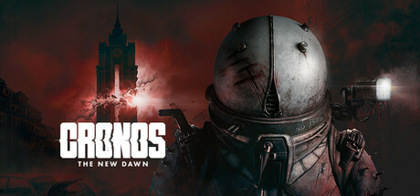

**Cronos: The New Dawn by Bloober Team (2024) is a survival horror set in communist Poland after a time anomaly.**

---

## 📖 About

Cronos: The New Dawn by Bloober Team (2024) is a survival horror set in communist Poland after a time anomaly. You play as a Traveler sent to retrieve lost souls, facing grotesque enemies across a fractured timeline. The Bloober Team pedigree ensures psychological horror but combat is punishingly scarce on resources.

## ⚠️ Problems Without Trainer

| Problem | Status |
|---------|--------|
| Ammunition runs out mid-encounter forcing improvised melee with weak weapons | ✅ Solved |
| Health regeneration too slow to sustain consecutive enemy encounters | ✅ Solved |
| Puzzle solutions in time-fractured areas require revisiting with no fast travel | ✅ Solved |
| Enemy mutations in late game require specific vulnerability exploitation | ✅ Solved |
| Safe room distances leave long stretches without health or ammo resupply | ✅ Solved |

## ✅ Solution

The **Cronos: The New Dawn Trainer** solves all these issues, giving you complete control so you can focus on enjoying the game.

## 🎯 Features

- Unlimited Resources / Currency
- God Mode / Invincibility
- Instant Skill & Ability Cooldown
- One-Hit Kill
- Freeze Timers
- Unlock All Items & Achievements
- Custom Speed Multiplier
- Infinite Stamina / Energy

## 🚀 Quick Start

1. **Disable Windows Defender** temporarily (trainer may trigger false positive)
2. Get the trainer from the button above
3. Launch Cronos: The New Dawn
4. Run the trainer as Administrator
5. Use the hotkeys to activate cheats in-game

## 💎 Free vs Pro

| Feature | Free | Pro |
|---------|------|-----|
| God Mode | ✅ | ✅ |
| Unlimited Resources | ✅ | ✅ |
| Advanced Cheats | ❌ | ✅ |
| Auto-Updates | ❌ | ✅ |
| Priority Support | ❌ | ✅ |

## 💻 Requirements

- Windows 10 / 11 (64-bit)
- Cronos: The New Dawn (any version)
- .NET Framework 4.8+
- DirectX 11+

## 🍎 macOS

## ⚖️ Legal

Educational and single-player use only.

---

